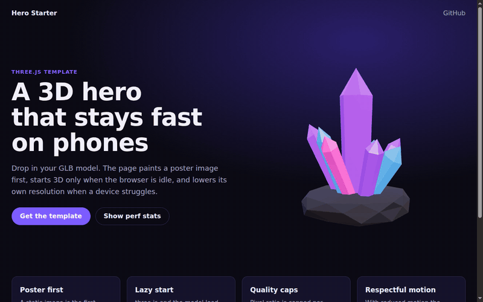
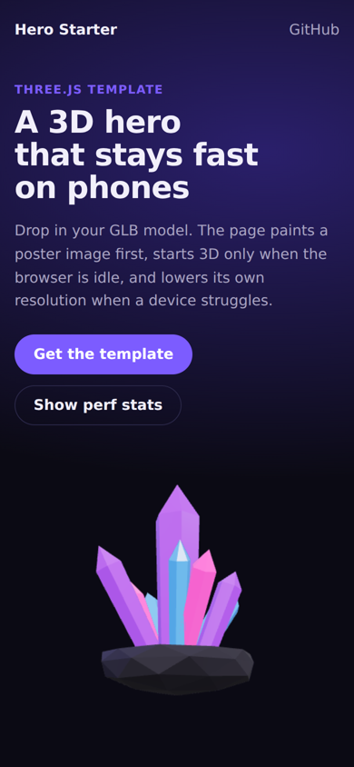

# threejs-hero-starter

[](https://github.com/vladosskins178/threejs-hero-starter/actions/workflows/ci.yml)
[](LICENSE)

A small Three.js 3D hero section for landing pages that stays fast on phones. No build step, no framework: copy three files, point it at your GLB model, done.

**Live demo:** https://vladosskins178.github.io/threejs-hero-starter/ (add [`?debug`](https://vladosskins178.github.io/threejs-hero-starter/?debug) to see the quality tier, pixel ratio and triangle count)



## Why

Most 3D hero sections look great on a laptop and then make a mid-range Android phone stutter, drain its battery, or show a blank box for three seconds. This template is built the other way round: the page is fast first, and 3D is a progressive enhancement on top.

| Problem | What the template does |
| --- | --- |
| Blank box while three.js downloads | A poster image is the first paint (and the LCP element). The canvas fades in over it only after the first 3D frame is drawn, in the same box, so nothing shifts. |
| 3D slows down the first load | three.js and the model are fetched only when the hero is near the viewport, inside `requestIdleCallback`. |
| No WebGL, model fails, slow network | The poster simply stays. Save-Data users never download 3D at all. A 12 s timeout guards the model. |
| Retina phones render 9x the pixels | Pixel ratio is capped at 2 on desktop and 1.5 on phones. Devices with 4 or fewer cores or 4 GB or less memory run at 1x and 30 fps. |
| Slow device during runtime | A governor watches the median frame time and steps resolution down (and later back up) in 0.25x steps. |
| Burning battery in the background | Rendering stops when the hero scrolls out of view or the tab is hidden. |
| Motion sensitivity | With `prefers-reduced-motion` the model holds a still pose and frames are only drawn on demand. |
| Scroll hijacking on touch screens | The canvas never captures touch; pages scroll normally. |



## Quick start

1. Copy `src/auto.js`, `src/hero.js`, `src/quality.js` and `src/style.css` into your site.
2. Add the import map and the markup:

```html
<link rel="stylesheet" href="src/style.css">
<script type="importmap">
  {
    "imports": {
      "three": "https://cdn.jsdelivr.net/npm/three@0.187.0/build/three.module.min.js",
      "three/addons/": "https://cdn.jsdelivr.net/npm/three@0.187.0/examples/jsm/"
    }
  }
</script>

<div class="hero-3d" data-model="assets/your-model.glb">
  
</div>

<script type="module">
  import { autoMount } from './src/auto.js';
  autoMount('.hero-3d');
</script>
```

3. Run any static server and open the page:

```bash
python3 -m http.server 8000   # or: npx serve
```

The hero is a square box (`aspect-ratio: 1 / 1`); size it with your own grid. The `style.css` here also contains the demo page styles. You only need the rules under `/* ---- 3D stage ---- */`.

## Using your own model

- Export a GLB. The model is centred and scaled to fit automatically, so units do not matter.
- Keep it light. For a hero, aim for under 50k triangles and under 2 MB; compress textures (KTX2 or WebP) and use [gltf-transform](https://gltf-transform.dev/) to optimise. The demo model has 278 triangles and weighs 21 KB.
- Make a matching poster so the swap from image to canvas is invisible:

```bash
npm install --no-save playwright && npx playwright install chromium
node tools/make_poster.mjs        # writes assets/poster.webp and assets/poster.png
```

The script renders the real scene in a browser with reduced motion on, so the poster is exactly the first 3D frame. On a server without a GPU, run it with `HEADED=1 xvfb-run -a node tools/make_poster.mjs`.

## API

```js
import { autoMount } from './src/auto.js';

// Lazy: waits until the element is near the viewport and the browser is idle,
// then loads three.js and the model. auto.js itself is about 1 KB.
autoMount('.hero-3d');
```

To mount right away and keep a handle (this imports three.js immediately):

```js
import { mountHero } from './src/hero.js';

const hero = await mountHero(document.querySelector('.hero-3d'), {
  model: 'assets/crystal.glb', // defaults to data-model
  debug: false,                // defaults to ?debug in the URL
});
hero?.destroy(); // null when 3D was skipped and the poster is shown
```

The element gets `data-state` (`loading`, `ready`, `fallback`, `destroyed`) and `data-tier` (`high`, `medium`, `low`, `off`) attributes you can style against or check in tests. `hero.scene`, `hero.camera` and `hero.renderer` are exposed if you want to add lights or effects.

The decisions live in [`src/quality.js`](src/quality.js) as plain functions with no DOM access, so the thresholds are easy to tune and are unit-tested.

## Project layout

```text
index.html             demo page (deployed to GitHub Pages)
src/auto.js            lazy entry point (no three.js import)
src/hero.js            scene, loading, render loop, fallbacks
src/quality.js         device tiers, resolution governor, frame limiter
src/style.css          stage styles + demo page styles
assets/crystal.glb     demo model, generated by tools/make_model.py (Blender)
tools/make_poster.mjs  renders the poster from the live scene
test/                  unit tests (node:test) and a Playwright smoke test
```

## Tests

```bash
npm test               # quality tiers, governor and frame limiter
node test/smoke.mjs    # needs Playwright: loads the page on desktop, phone and reduced-motion
                       # profiles and fails on any script error, 404 or horizontal overflow
```

CI runs both on every push.

## License

[MIT](LICENSE) © 2026 Vladislav Y. The demo model is generated from Blender primitives by `tools/make_model.py` and is covered by the same license. three.js is MIT licensed and loaded from jsDelivr.

Built at [VL Studio](https://vlstudio.app), where we make fast interactive 3D sites and web apps.
